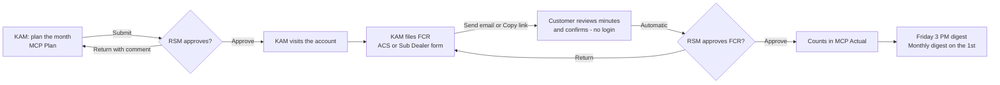

# ACS Sales Operations – User guide

## The process

## Key Account Managers (KAM)

**Before the month**
1. *MCP Plan* → **Plan [next month]**. Click a day's **+** to add a visit (account, AM/PM, purpose). The dealer list is the one the TTA plan gives you **for that month**. *Copy last month* gives you a starting point.
2. **Submit for approval**. If your RSM returns it, the comment shows at the top; fix and submit again. Need to change an approved plan? **Revise** (it goes back for approval).

**After every visit**
1. *Field Contact Reports* → **New FCR** → set the **visit date**, then pick the account. **My dealers** lists the dealers assigned to you in the TTA plan for the month of the visit (by BP code); a dealer that moved to another KAM in that month is not listed. **My sub-dealers** lists the sub-dealers you added. Visiting a new sub-dealer? Click **+ Sub-dealer**, enter it under one of your dealers, and it is selected for the FCR. Dealers cannot be typed in: if one is missing, ask the ACS admin to check the TTA plan.
   - The form (ACS or Sub Dealer) follows the account type; the header fills from the account profile.
   - Dealer FCRs open with **Sales Update – Account Target vs Actual Sales**: the target for the visit month, the quarter and the year (TTA plan), and actual sales per month from the final DSR. Use it to discuss the account's performance. The customer sees the same figures in the minutes.
2. Fill the sections you covered. Get-Back Items and Coverage Notes are what the customer will read most closely. *Preview minutes* shows exactly what they will see.
3. **Take the visit photo** with the customer (ask them first). One photo per FCR, and it is **required** before you can send for acknowledgement. Photos are taken **only on a phone, with the app's live camera**. There is no gallery and no file upload. **Location is required**: allow it when asked, or the shutter stays off. The time, your name and the place are stamped on the photo. Started the FCR on a laptop? Tap **Take the photo on my phone**, scan the QR code, sign in on the phone if asked, and the FCR opens at the photo step. The laptop page shows the photo by itself once it's saved. You can retake it until the request goes out; after that it is locked.
   - If you edit the same FCR on two devices, the app stops the older one from overwriting the newer save and asks you to reload.
4. Enter the **attendee name** (required), then send the acknowledgement request either way:
   - **By email**: enter the attendee's email address.
   - **By Viber**: enter the **Viber number** and the **number owner** (whose number it is). The app records the request, copies a ready-made message and opens a Viber chat with that number. Paste and send. Send it to that same number so the record matches.
   - Both are recorded under *Where the request went* (channel, number or address, owner, time). Your RSM sees this on the FCR, in the approval queue and in the PDF. **Copy link only** is for other apps; it does not record a recipient, so prefer Viber or email.
5. The customer sees the minutes **and the visit photo** on the link, and confirms both with **Confirm the minutes and photo**. The FCR then goes to your RSM automatically. The dashboard shows anything still waiting.
6. If the RSM returns it, correct it and send for acknowledgement again (changing the report after the customer confirmed means they must confirm the new version).

**Notes**
- The visit date locks once you request acknowledgement, and can't be in the future.
- *MCP Actual* shows approved visits (green), planned visits still upcoming (blue) and planned visits with no approved FCR (red). Add a **day note** for leave, office days or trainings. **Generate and export PDF** saves a snapshot to the MCP Archive.
- *Joint visit*: name up to two companions; they can view the FCR and don't file their own.

## Regional Sales Managers (RSM)

- You approve your KAMs' FCRs and MCP Plans. RSMs do not file FCRs or MCP Plans of their own.
- Sidebar badges show what's waiting. **FCR approvals**: *Review* shows the confirmed minutes, who confirmed and when, and where the request was sent (e.g. *Sent via Viber to +63917… (Juan Cruz)*); **Approve** or **Return** (a comment is required to return). You can tick several and approve together.
- The customer confirms the minutes with the visit photo shown; the photo panel says **Customer: Confirmed with this photo shown** and the date.
- Each FCR shows the **visit photo** with its time, the place and a map link. Meetings away from the customer's office (meals, other venues) are normal, so the app does not flag distance; you judge. It only flags a photo dated on a different day than the visit, or a missing location. Photo files are deleted after 60 days; the time, place and map link stay.
- Check that the number or address belongs to the customer named in the FCR. The app records what the KAM entered; it cannot read the Viber conversation itself.
- **MCP Plan approvals**: expand to see the calendar, then approve or return.
- *Dashboard → Team overview* shows each KAM's week (drafts, awaiting customer, pending, approved, returned) and MCP Plan / Actual for the month. Click a KAM to open their MCP Actual.
- *Weekly report* = the Friday email, any week, with **Download PDFs (.zip)**. *Visitation census* shows weekly counts with zero weeks in red. *Export center* gives Excel, one combined PDF, or a zip for any period.

## Channel Head and Director

Same reports for your whole branch, grouped by RSM. You receive the Friday and monthly roll-up digests. You don't file FCRs or MCP Plans and have no approval queue: only KAMs file, and each KAM's RSM approves.

## Admins

- Admins see every record and every report across all of ACS, and receive the Friday and monthly digest for the whole team (subject "All ACS"). Approvals stay with each KAM's RSM.
- *Users and org chart*: edit the roster (role, team, **Reports to**, digest email) → **Save and sync**. Click a user's access chip to make them read-only. New people also need a login (see docs/SETUP.md step 4).
- *Targets and sales*: **TTA plan** – upload the ACS Master Monitoring (TTA plan) file, CSV or Excel. The page checks it first (dealers, totals, KAMs per month, names not yet mapped to a person) and loads only when nothing blocks it. Dealers are created or updated by **BP code**. The first load covers the whole year; later loads replace the current month to December, and restating past months needs a reason. **Monthly DSR** – upload the final DSR of a month; the app sums **Actual Sales** per **BP Code**. Loading a month again replaces it. **Plan names** maps the names in the plan (e.g. "HADJIE TECSON") to people; **History** lists every upload.
- *Delete an FCR* (duplicates, test entries, wrong account): open the FCR → **Delete** → type the reason. The FCR, its photo and its request history are removed for everyone; a full copy is kept in the admin-only deletion log (`fcr_deletions`). Cannot be undone from the app.
- *Email log*: every email attempt. **Preview weekly/monthly** and **Test weekly to me** before launch and after any change.

## Everyone

- *Account* (bottom left): change your password; set a different address for report emails.
- Accounts are shared across the team. Dealers come only from the TTA plan (BP code, KAM per month); their name and BP code can't be edited in the app. KAMs add sub-dealers, under a dealer they hold that month. A sub-dealer follows its dealer when the dealer moves to another KAM. Search **All** before adding one, to avoid duplicates.
